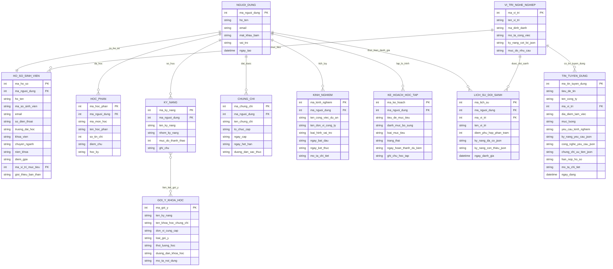

# THIẾT KẾ CƠ SỞ DỮ LIỆU HỆ THỐNG (TÊN BẢNG TIẾNG VIỆT KHÔNG DẤU & MÃ MERMAID CHO DRAW.IO)

**Đề tài:** Xây dựng ứng dụng hỗ trợ định hướng kỹ năng nghề nghiệp cho sinh viên CNTT dựa trên tin tuyển dụng (`NLCNPM23CS-38`)

---

## 1. TỔNG QUAN 11 BẢNG DỮ LIỆU THEO CHỨC NĂNG

| STT | Tên bảng (Tiếng Việt không dấu) | Tên bảng trong Code (`models.py`) | Chức năng phục vụ | Phụ trách |
| :-: | :--- | :--- | :--- | :-: |
| 1 | **`NGUOI_DUNG`** | `users` | Đăng ký, đăng nhập, phân quyền và bảo mật tài khoản. | Thành viên 1 |
| 2 | **`HO_SO_SINH_VIEN`** | `student_profiles` | Lưu thông tin cá nhân, trường/khoa, GPA và vị trí nghề nghiệp mục tiêu. | Thành viên 1 |
| 3 | **`HOC_PHAN`** | `courses` | Quản lý danh sách các môn học/học phần đại học sinh viên đã học. | Thành viên 1 |
| 4 | **`KY_NANG`** | `skills` | Quản lý kỹ năng chuyên môn của sinh viên và mức độ thành thạo (1–5 sao). | Thành viên 1 |
| 5 | **`CHUNG_CHI`** | `certificates` | Quản lý các chứng chỉ quốc tế, chuyên môn và ngoại ngữ của sinh viên. | Thành viên 1 |
| 6 | **`KINH_NGHIEM`** | `experiences` | Quản lý lịch sử thực tập, đồ án môn học và dự án thực tế của sinh viên. | Thành viên 1 |
| 7 | **`VI_TRI_NGHE_NGHIEP`** | `positions` | Danh mục các vị trí nghề nghiệp CNTT và bộ kỹ năng cốt lõi chuẩn. | Thành viên 1 |
| 8 | **`TIN_TUYEN_DUNG`** | `jobs` | Lưu trữ tin tuyển dụng từ doanh nghiệp (nhập tay hoặc nhập từ CSV). | Thành viên 1 |
| 9 | **`KE_HOACH_HOC_TAP`** | `learning_plans` | Theo dõi lộ trình bổ sung kỹ năng/chứng chỉ (`todo`, `doing`, `done`). | Thành viên 2 |
| 10 | **`GOI_Y_KHOA_HOC`** | `course_recommendations` | Kho dữ liệu gợi ý khóa học và chứng chỉ tương ứng với từng kỹ năng thiếu. | Thành viên 2 |
| 11 | **`LICH_SU_DOI_SANH`** | `comparison_history` | Lưu kết quả chấm điểm độ phù hợp (%), kỹ năng đã có và còn thiếu. | Thành viên 2 |

---

## 2. MÃ MERMAID VẼ SƠ ĐỒ ERD TRÊN DRAW.IO

> **Hướng dẫn đưa vào Draw.io (diagrams.net):**
> 1. Mở [https://app.diagrams.net](https://app.diagrams.net) (Draw.io).
> 2. Trên thanh menu, chọn **Arrange** (Sắp xếp) ➔ **Insert** (Chèn) ➔ **Advanced** (Nâng cao) ➔ **Mermaid...**
> 3. Copy toàn bộ đoạn mã bên dưới dán vào ô nhập và bấm **Insert**.

---

## 3. ĐẶC TẢ CHI TIẾT CÁC BẢNG DỮ LIỆU (DÙNG CHO BÁO CÁO NIÊN LUẬN)

### 3.1. Bảng `NGUOI_DUNG` (Tài khoản người dùng)
| Tên thuộc tính | Kiểu dữ liệu | Ràng buộc | Giải thích |
| :--- | :--- | :--- | :--- |
| `ma_nguoi_dung` | `INTEGER` | `PRIMARY KEY, AUTOINCREMENT` | Mã định danh duy nhất của người dùng |
| `ho_ten` | `TEXT` | `NOT NULL` | Họ và tên đầy đủ của sinh viên |
| `email` | `TEXT` | `NOT NULL, UNIQUE` | Địa chỉ email đăng nhập |
| `mat_khau_bam` | `TEXT` | `NOT NULL` | Mật khẩu đã mã hóa một chiều (`PBKDF2/SHA256`) |
| `vai_tro` | `TEXT` | `DEFAULT 'student'` | Vai trò người dùng trong hệ thống |
| `ngay_tao` | `TIMESTAMP` | `DEFAULT CURRENT_TIMESTAMP` | Thời điểm tạo tài khoản |

### 3.2. Bảng `HO_SO_SINH_VIEN` (Thông tin cá nhân sinh viên)
| Tên thuộc tính | Kiểu dữ liệu | Ràng buộc | Giải thích |
| :--- | :--- | :--- | :--- |
| `ma_ho_so` | `INTEGER` | `PRIMARY KEY, AUTOINCREMENT` | Mã hồ sơ sinh viên |
| `ma_nguoi_dung` | `INTEGER` | `FOREIGN KEY, UNIQUE` | Liên kết 1-1 với bảng `NGUOI_DUNG` |
| `ho_ten` | `TEXT` | `NOT NULL` | Họ tên hiển thị trên hồ sơ |
| `ma_so_sinh_vien` | `TEXT` | `DEFAULT ''` | Mã số sinh viên (MSSV) |
| `email` | `TEXT` | `NOT NULL` | Email liên hệ của sinh viên |
| `so_dien_thoai` | `TEXT` | `DEFAULT ''` | Số điện thoại liên hệ |
| `truong_dai_hoc` | `TEXT` | `DEFAULT ''` | Tên trường đại học đang theo học |
| `khoa_vien` | `TEXT` | `DEFAULT ''` | Tên Khoa / Viện đào tạo |
| `chuyen_nganh` | `TEXT` | `DEFAULT ''` | Chuyên ngành (CNTT, KHMT, KTPM...) |
| `nien_khoa` | `TEXT` | `DEFAULT ''` | Khóa học / Niên khóa |
| `diem_gpa` | `TEXT` | `DEFAULT '0.0'` | Điểm trung bình tích lũy hệ 4 |
| `ma_vi_tri_muc_tieu` | `INTEGER` | `FOREIGN KEY` | Liên kết tới bảng `VI_TRI_NGHE_NGHIEP` |
| `gioi_thieu_ban_than` | `TEXT` | `DEFAULT ''` | Mục tiêu nghề nghiệp và giới thiệu ngắn |

### 3.3. Bảng `HOC_PHAN` (Học phần đã học)
| Tên thuộc tính | Kiểu dữ liệu | Ràng buộc | Giải thích |
| :--- | :--- | :--- | :--- |
| `ma_hoc_phan` | `INTEGER` | `PRIMARY KEY, AUTOINCREMENT` | Mã bản ghi học phần |
| `ma_nguoi_dung` | `INTEGER` | `FOREIGN KEY` | Sinh viên sở hữu học phần |
| `ma_mon_hoc` | `TEXT` | `NOT NULL` | Mã môn học (VD: `IT3011`, `IT4010`) |
| `ten_hoc_phan` | `TEXT` | `NOT NULL` | Tên học phần (VD: *Lập trình Web*) |
| `so_tin_chi` | `INTEGER` | `DEFAULT 3` | Số tín chỉ của học phần |
| `diem_chu` | `TEXT` | `DEFAULT 'A'` | Điểm chữ đạt được (`A+`, `A`, `B+`, `B`...) |
| `hoc_ky` | `TEXT` | `DEFAULT ''` | Học kỳ hoàn thành (VD: `2023.1`) |

### 3.4. Bảng `KY_NANG` (Kỹ năng cá nhân)
| Tên thuộc tính | Kiểu dữ liệu | Ràng buộc | Giải thích |
| :--- | :--- | :--- | :--- |
| `ma_ky_nang` | `INTEGER` | `PRIMARY KEY, AUTOINCREMENT` | Mã bản ghi kỹ năng |
| `ma_nguoi_dung` | `INTEGER` | `FOREIGN KEY` | Sinh viên sở hữu kỹ năng |
| `ten_ky_nang` | `TEXT` | `NOT NULL` | Tên kỹ năng (VD: `Python`, `SQL`, `Docker`) |
| `nhom_ky_nang` | `TEXT` | `DEFAULT 'Ngôn ngữ lập trình'` | Phân loại kỹ năng |
| `muc_do_thanh_thao` | `INTEGER` | `CHECK (1..5)` | Mức độ tự đánh giá từ 1 đến 5 sao |
| `ghi_chu` | `TEXT` | `DEFAULT ''` | Ghi chú thực tế sử dụng kỹ năng |

### 3.5. Bảng `CHUNG_CHI` (Chứng chỉ chuyên môn & ngoại ngữ)
| Tên thuộc tính | Kiểu dữ liệu | Ràng buộc | Giải thích |
| :--- | :--- | :--- | :--- |
| `ma_chung_chi` | `INTEGER` | `PRIMARY KEY, AUTOINCREMENT` | Mã bản ghi chứng chỉ |
| `ma_nguoi_dung` | `INTEGER` | `FOREIGN KEY` | Sinh viên sở hữu chứng chỉ |
| `ten_chung_chi` | `TEXT` | `NOT NULL` | Tên chứng chỉ (VD: `TOEIC 785`, `AWS CCP`) |
| `to_chuc_cap` | `TEXT` | `NOT NULL` | Tổ chức cấp chứng chỉ (`ETS`, `AWS`, `Coursera`) |
| `ngay_cap` | `TEXT` | `DEFAULT ''` | Ngày cấp (`YYYY-MM-DD`) |
| `ngay_het_han` | `TEXT` | `DEFAULT ''` | Ngày hết hạn (trống nếu vô thời hạn) |
| `duong_dan_xac_thuc` | `TEXT` | `DEFAULT ''` | Đường dẫn URL kiểm tra chứng chỉ |

### 3.6. Bảng `KINH_NGHIEM` (Kinh nghiệm & Dự án thực tế)
| Tên thuộc tính | Kiểu dữ liệu | Ràng buộc | Giải thích |
| :--- | :--- | :--- | :--- |
| `ma_kinh_nghiem` | `INTEGER` | `PRIMARY KEY, AUTOINCREMENT` | Mã bản ghi kinh nghiệm |
| `ma_nguoi_dung` | `INTEGER` | `FOREIGN KEY` | Sinh viên sở hữu kinh nghiệm |
| `ten_cong_viec_du_an` | `TEXT` | `NOT NULL` | Chức danh hoặc tên dự án/đồ án |
| `ten_don_vi_cong_ty` | `TEXT` | `NOT NULL` | Tên doanh nghiệp hoặc nhóm dự án |
| `loai_hinh_vai_tro` | `TEXT` | `DEFAULT 'Thực tập sinh'` | Thực tập sinh / Đồ án / Dự án cá nhân |
| `ngay_bat_dau` | `TEXT` | `DEFAULT ''` | Thời gian bắt đầu (`YYYY-MM-DD`) |
| `ngay_ket_thuc` | `TEXT` | `DEFAULT ''` | Thời gian kết thúc |
| `mo_ta_chi_tiet` | `TEXT` | `DEFAULT ''` | Công nghệ sử dụng và kết quả đạt được |

### 3.7. Bảng `VI_TRI_NGHE_NGHIEP` (Danh mục vị trí CNTT)
| Tên thuộc tính | Kiểu dữ liệu | Ràng buộc | Giải thích |
| :--- | :--- | :--- | :--- |
| `ma_vi_tri` | `INTEGER` | `PRIMARY KEY, AUTOINCREMENT` | Mã vị trí nghề nghiệp |
| `ten_vi_tri` | `TEXT` | `NOT NULL` | Tên vị trí (VD: *Backend Developer*) |
| `ma_dinh_danh` | `TEXT` | `DEFAULT ''` | Mã code chuẩn (VD: `BACKEND_DEV`) |
| `mo_ta_cong_viec` | `TEXT` | `DEFAULT ''` | Mô tả đặc thù công việc của vị trí |
| `ky_nang_cot_loi_json` | `TEXT` | `DEFAULT '[]'` | Danh sách kỹ năng cốt lõi dạng JSON |
| `muc_do_nhu_cau` | `TEXT` | `DEFAULT 'Cao'` | Mức nhu cầu thị trường (`Rất cao`, `Cao`...) |

### 3.8. Bảng `TIN_TUYEN_DUNG` (Dữ liệu tin tuyển dụng)
| Tên thuộc tính | Kiểu dữ liệu | Ràng buộc | Giải thích |
| :--- | :--- | :--- | :--- |
| `ma_tin_tuyen_dung` | `INTEGER` | `PRIMARY KEY, AUTOINCREMENT` | Mã tin tuyển dụng |
| `tieu_de_tin` | `TEXT` | `NOT NULL` | Tiêu đề bài đăng tuyển dụng |
| `ten_cong_ty` | `TEXT` | `NOT NULL` | Tên doanh nghiệp tuyển dụng |
| `ma_vi_tri` | `INTEGER` | `FOREIGN KEY` | Liên kết tới bảng `VI_TRI_NGHE_NGHIEP` |
| `dia_diem_lam_viec` | `TEXT` | `DEFAULT 'Toàn quốc'` | Tỉnh/Thành phố làm việc |
| `muc_luong` | `TEXT` | `DEFAULT 'Thỏa thuận'` | Mức đãi ngộ dự kiến |
| `yeu_cau_kinh_nghiem` | `TEXT` | `DEFAULT 'Không yêu cầu'` | Số năm kinh nghiệm yêu cầu |
| `ky_nang_yeu_cau_json` | `TEXT` | `DEFAULT '[]'` | Mảng JSON các kỹ năng yêu cầu |
| `cong_nghe_yeu_cau_json`| `TEXT` | `DEFAULT '[]'` | Mảng JSON các công nghệ/framework |
| `chung_chi_uu_tien_json`| `TEXT` | `DEFAULT '[]'` | Mảng JSON các chứng chỉ ưu tiên |
| `han_nop_ho_so` | `TEXT` | `DEFAULT ''` | Hạn chót ứng tuyển |
| `mo_ta_chi_tiet` | `TEXT` | `DEFAULT ''` | Nội dung mô tả chi tiết công việc |
| `ngay_dang` | `TIMESTAMP` | `DEFAULT CURRENT_TIMESTAMP` | Ngày nhập tin vào hệ thống |

### 3.9. Bảng `KE_HOACH_HOC_TAP` (Lộ trình phát triển năng lực)
| Tên thuộc tính | Kiểu dữ liệu | Ràng buộc | Giải thích |
| :--- | :--- | :--- | :--- |
| `ma_ke_hoach` | `INTEGER` | `PRIMARY KEY, AUTOINCREMENT` | Mã mục tiêu học tập |
| `ma_nguoi_dung` | `INTEGER` | `FOREIGN KEY` | Sinh viên lập kế hoạch |
| `tieu_de_muc_tieu` | `TEXT` | `NOT NULL` | Nội dung kỹ năng/chứng chỉ cần học |
| `danh_muc_bo_sung` | `TEXT` | `DEFAULT 'Kỹ năng bổ sung'` | Nhóm mục tiêu |
| `loai_muc_tieu` | `TEXT` | `DEFAULT 'skill'` | Loại (`skill`, `certificate`, `project`) |
| `trang_thai` | `TEXT` | `DEFAULT 'todo'` | Trạng thái (`todo`, `doing`, `done`) |
| `ngay_hoan_thanh_du_kien`| `TEXT` | `DEFAULT ''` | Hạn mục tiêu hoàn thành |
| `ghi_chu_hoc_tap` | `TEXT` | `DEFAULT ''` | Tài liệu, nguồn học tập chi tiết |

### 3.10. Bảng `GOI_Y_KHOA_HOC` (Kho gợi ý học tập & chứng chỉ)
| Tên thuộc tính | Kiểu dữ liệu | Ràng buộc | Giải thích |
| :--- | :--- | :--- | :--- |
| `ma_goi_y` | `INTEGER` | `PRIMARY KEY, AUTOINCREMENT` | Mã gợi ý học tập |
| `ten_ky_nang` | `TEXT` | `NOT NULL` | Kỹ năng còn thiếu cần tra cứu |
| `ten_khoa_hoc_chung_chi`| `TEXT` | `NOT NULL` | Tên khóa học hoặc chứng chỉ đề xuất |
| `don_vi_cung_cap` | `TEXT` | `DEFAULT ''` | Nền tảng đào tạo (`Coursera`, `Udemy`, `AWS`) |
| `loai_goi_y` | `TEXT` | `DEFAULT 'course'` | Phân loại (`course` hoặc `certificate`) |
| `thoi_luong_hoc` | `TEXT` | `DEFAULT '4 tuần'` | Thời lượng hoàn thành dự kiến |
| `duong_dan_khoa_hoc` | `TEXT` | `DEFAULT ''` | Link tham khảo khóa học |
| `mo_ta_noi_dung` | `TEXT` | `DEFAULT ''` | Tóm tắt nội dung kiến thức bổ sung |

### 3.11. Bảng `LICH_SU_DOI_SANH` (Lịch sử đánh giá độ phù hợp)
| Tên thuộc tính | Kiểu dữ liệu | Ràng buộc | Giải thích |
| :--- | :--- | :--- | :--- |
| `ma_lich_su` | `INTEGER` | `PRIMARY KEY, AUTOINCREMENT` | Mã lần đánh giá hồ sơ |
| `ma_nguoi_dung` | `INTEGER` | `FOREIGN KEY` | Sinh viên thực hiện đối sánh |
| `ma_vi_tri` | `INTEGER` | `FOREIGN KEY` | Vị trí nghề nghiệp được đối sánh |
| `ten_vi_tri` | `TEXT` | `NOT NULL` | Tên vị trí tại thời điểm đánh giá |
| `diem_phu_hop_phan_tram`| `INTEGER` | `DEFAULT 0` | Điểm độ phù hợp đạt được (0–100%) |
| `ky_nang_da_co_json` | `TEXT` | `DEFAULT '[]'` | Danh sách kỹ năng đã đáp ứng (JSON) |
| `ky_nang_con_thieu_json` | `TEXT` | `DEFAULT '[]'` | Danh sách kỹ năng còn thiếu (JSON) |
| `ngay_danh_gia` | `TIMESTAMP` | `DEFAULT CURRENT_TIMESTAMP` | Thời điểm lưu kết quả đối sánh |

